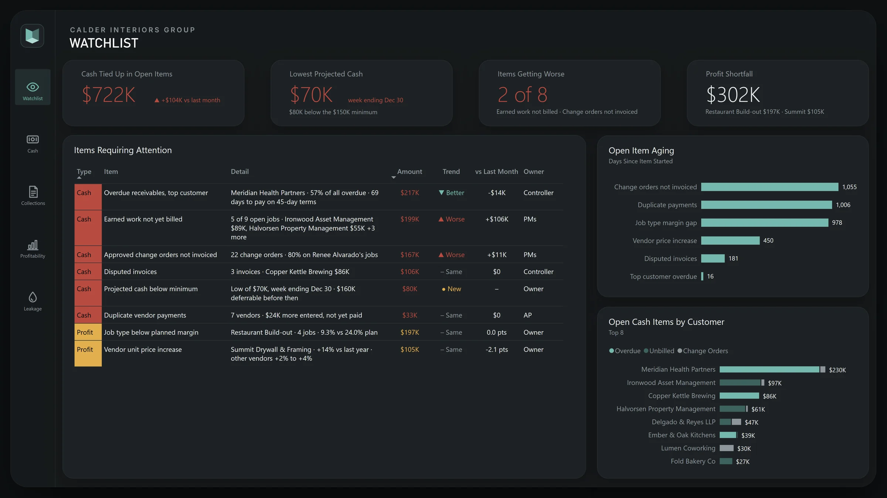

# Case studies

-   **[Cash flow and job profitability](projects/cash-flow-job-profitability.md)**

    ---

    

    Construction, finance. QuickBooks Online and six spreadsheets piped into Postgres and a six-page Power BI report showing where a contractor's cash is stuck and which jobs lose money.

    [Read the case study](projects/cash-flow-job-profitability.md){ .md-button }

## Client work

-   **Well characterization dashboard**

    ---

    Oil and gas, Power BI. Complex Excel workbooks turned into a star-schema model and an interactive report for comparing wells. About 35 hours, and the client came back for more work.

-   **Real estate portfolio dashboard**

    ---

    Real estate, Power BI. Occupancy, revenue, expenses, and ROI across a property portfolio in one documented report, delivered within two days.

## Personal builds

-   **repIQ**

    ---

    An iOS workout tracking app with an analytics focus, built solo in Swift and SwiftUI and now in TestFlight beta.

