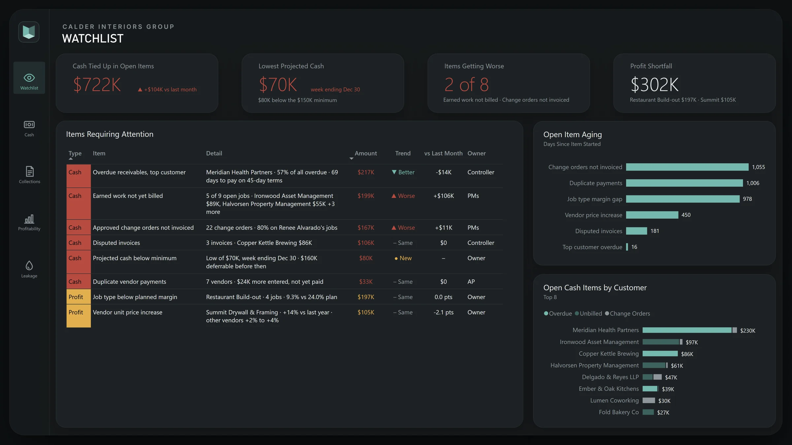
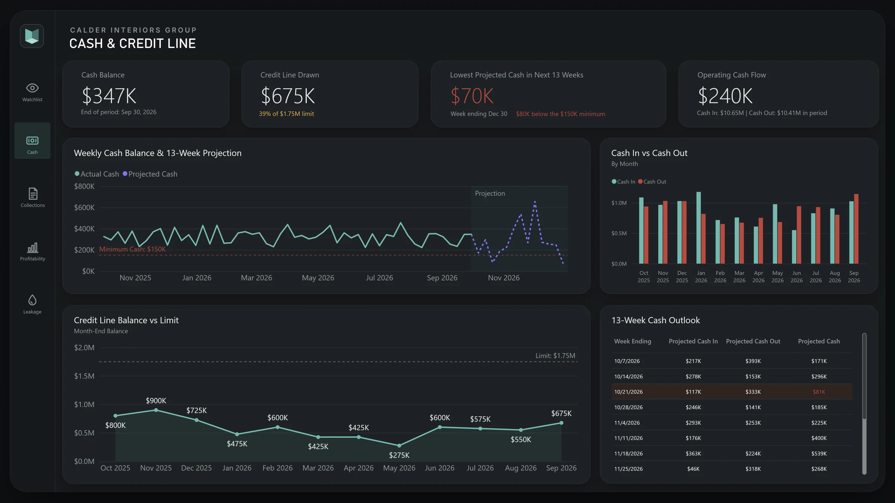
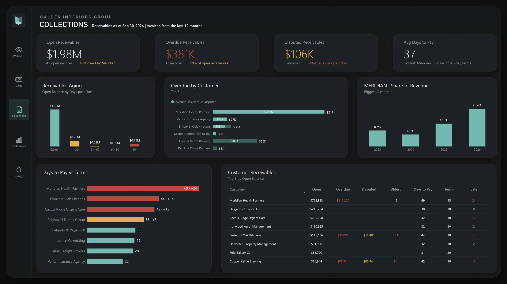
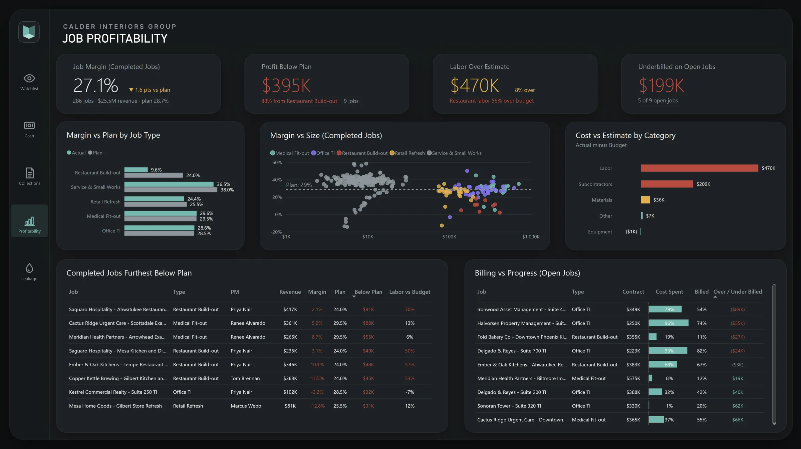
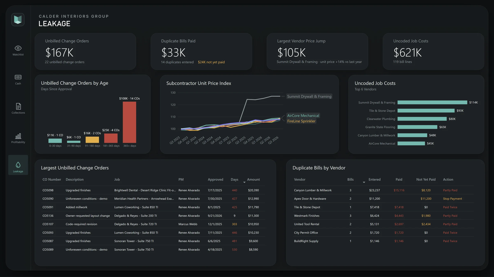
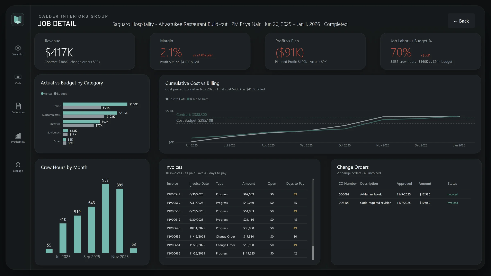

# Cash flow and job profitability

!!! abstract "At a glance"
    **Company**: Calder Interiors Group, a $10.8M commercial interiors contractor  
    **Problem**: Profitable on paper, short on cash, and unable to say which jobs and customers made money  
    **Deliverable**: A data pipeline from QuickBooks Online and six spreadsheets into Postgres, and a six-page Power BI report  
    **Role**: Sole builder, from source systems through the report

!!! note "About this case study"
    I built this case study to show how I work from start to finish. Calder Interiors is a fictional company, and the data is realistic sample data I generated, loaded into a real QuickBooks Online sandbox, and pulled back out the way I would for a client.

The Watchlist, the report's opening page: eight rule-based checks, how much money each one involves, and whether it is getting better or worse than last month.

## Challenge

Calder builds out offices, clinics, restaurants and retail spaces. Revenue was growing and the books showed a profit, yet the company kept drawing on its credit line to cover the gaps.

The owner and controller could not answer basic questions without days of spreadsheet work:

- How low will cash get over the next quarter, and when?
- Who owes us money, and how late do they really pay?
- Which kinds of jobs make money, and which ones only look busy?
- Where is money slipping out between the field, the office and the books?

The answers were spread across systems that never met. The books lived in QuickBooks Online. Hours came from a timesheet app, budgets from the estimating spreadsheet, and change orders from a log the project managers kept. Each one held part of the picture.

## Approach

- **Pull every source into one place.** A Python extract reads QuickBooks Online through its API (customers, jobs, invoices, payments, bills and the credit line) and six files from a shared Google Drive folder: timesheets, payroll, job budgets, the change order log, the job schedule and planned payments. Everything lands in a Postgres database.
- **Clean it once, upstream.** SQL models fix what real books always contain, such as duplicate customer records, mislabeled job types and bills entered twice. Then they shape the data into a star schema that Power BI reads directly. The cleanup isn't buried in Power Query, so every report built on this data gets the same answers.
- **Check the numbers before anyone sees them.** Totals in the model reconcile to QuickBooks to the cent, and every figure in the report was checked against an independent audit query before the page was signed off.
- **Build the report around decisions.** Each page answers one question an owner or controller asks every week. The Watchlist flags issues with fixed business rules and adjustable thresholds, such as "approved change orders not invoiced", rather than pre-written conclusions, so it keeps working as the data changes.

## Architecture

QuickBooks Online API
Google Drive spreadsheets
Python extract
Postgres (Neon)
SQL staging and star schema
Power BI report

## What the report surfaced

### Cash is tight for a reason it can fix

The 13-week projection shows cash falling to **$70K in late December, $80K below the company's $150K minimum**, with $675K already drawn on the credit line. Meanwhile **$722K is tied up in open items**: overdue invoices, finished work not yet billed, and approved change orders never invoiced. That is about nine times the shortfall. The gap is a collection and billing problem, not a lack of business.

### One customer drives the collection problem

**Meridian Health Partners owes 40% of open receivables** and pays in 69 days on 45-day terms. Its share of revenue has tripled in two years, from 6.5% to 20.4%, so Calder is moving more of its work to its slowest-paying customer. Another **$106K sits in disputed invoices**, the oldest 181 days past due.

### Restaurant jobs lose most of the planned profit

Restaurant build-outs earn **9.6% against a 24% plan**, and labor runs 56% over the estimate. They account for most of the profit lost against plan. Every other job type lands close to its estimate. Open jobs tell a separate story: **$199K of finished work hasn't been billed yet** across five of nine jobs.

### Money is leaking out between systems

- **$167K in approved change orders was never invoiced.** Most are over a year old, and they cluster on one project manager's jobs, which points to a process gap rather than a one-off.
- **14 duplicate vendor bills were entered**, $33K of them already paid twice. Another $24K hasn't been paid yet and can still be stopped.
- **One subcontractor raised unit prices 14%** in a year, while comparable vendors rose 2–4%.

### Every number traces back to a job

Any job in the report drills through to its own page: cost against budget by category, cumulative cost against billing, crew hours by month, and every invoice and change order. This one, a restaurant build-out, finished at a 2.1% margin with labor 70% over budget. The report shows exactly when its costs passed the budget.

## Before and after

| | Before | After |
| --- | --- | --- |
| **Cash outlook** | Bank balance today and a gut feel | A 13-week projection against the minimum, refreshed with the data |
| **Job profitability** | Known months after a job closed, if at all | Margin against plan by job type, with labor and subcontractor overruns |
| **Change orders** | A PM spreadsheet nobody checked against invoices | Every approved change order matched to billing, by age |
| **Where to start** | Whatever was loudest that week | A ranked watchlist with dollar amounts and trends |

## Cost to run

The whole stack runs on free tiers. Neon's free Postgres plan holds the database, and the QuickBooks API and Google Drive cost nothing to use. The only paid piece is Power BI Pro, about $14 per user per month, and only for people who view the report in the Power BI Service. A small company can run this for the price of a few Power BI licenses, with no data warehouse to maintain.

## What's next

- Scheduled daily refreshes, so the report updates without anyone running the extract
- Monthly snapshots, so the month-over-month trends come from saved history rather than being rebuilt from the data
- Moving the SQL models to dbt, with tests on every model

## Tech stack

- QuickBooks Online API and Google Drive API
- Python
- PostgreSQL (Neon) and SQL
- Power BI (DAX, star schema, drill-through)

-   :material-calendar-check:{ .lg .middle } Running a contracting or project business on QuickBooks?

    ---

    Book a free 30-minute intro call. Tell me what you are trying to answer about your cash or your jobs, and I will tell you honestly whether I can help and what it would take.

    [Book a free intro call :material-arrow-top-right:](https://cal.com/alfonso-magallon/intro-call){ .md-button .md-button--primary }

